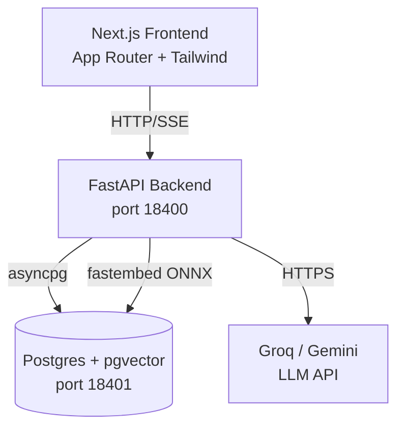

# Placement Copilot

RAG-powered Q&A over college placement notices. Students paste or upload placement notices; the system answers questions about eligibility, deadlines, and process with cited answers drawn from the uploaded text.

Built as a portfolio project to demonstrate full-stack RAG with TypeScript/Next.js frontend and a FastAPI + pgvector backend. All data in this repository is **synthetic** (fictional company names, generated notices). No real student or company data is used or stored.

---

## Architecture



**Ingestion flow:**  
Notice text → parser → chunker (400-word windows, 80-word overlap) → fastembed BAAI/bge-small-en-v1.5 (ONNX, no torch) → pgvector + tsvector index

**Q&A flow:**  
Question → hybrid retrieval (vector cosine + BM25-ish, combined with RRF) → LLM (Groq llama-3.1-8b-instant, Gemini flash fallback) → cited answer → SSE stream to browser

**Eligibility checks:** deterministic rule engine (no LLM); student profile stays in localStorage, is never stored server-side.

---

## Quickstart

**Requirements:** Python 3.12+, Node 22+, Docker

```bash
# 1. Start Postgres with pgvector
docker run -d --name placement-copilot-db \
  -e POSTGRES_USER=copilot -e POSTGRES_PASSWORD=copilot \
  -e POSTGRES_DB=placement_copilot \
  -p 18401:5432 pgvector/pgvector:pg17

# 2. Backend
cd backend
cp .env.example .env        # fill in GROQ_API_KEY or GEMINI_API_KEY
pip install -r requirements.txt
uvicorn app.main:app --port 18400 --reload

# 3. Generate synthetic corpus and ingest it
cd ../data/synthetic
python generator.py         # writes notices to data/synthetic/notices/
# Then POST each file to /api/v1/ingest/text (see scripts/seed.py)

# 4. Frontend
cd ../../frontend
cp .env.local.example .env.local   # set NEXT_PUBLIC_API_URL=http://localhost:18400
npm install
npm run dev
```

---

## Results

Measured on a laptop (Windows 11, 16 GB RAM) with synthetic corpus (25 drives, ~50 notices).  
All numbers from `VERIFY.md`.

| Metric | Value | Notes |
|--------|-------|-------|
| Unit tests | 35 passed | parser, eligibility, extractor, generator |
| Integration tests | 8 passed | real Postgres/pgvector |
| Frontend unit tests | 10 passed | vitest |
| Extraction / CGPA accuracy | 1.000 | fake LLM mode; real LLM TBD |
| Retrieval recall@5 | measured in VERIFY.md | hybrid RRF |
| Refusal accuracy | measured in VERIFY.md | 8 unanswerable questions |
| Ingest latency (single notice) | see VERIFY.md | includes embed |
| Cold embed model load | ~10s first run | ONNX model cached after |

---

## Design decisions

- **fastembed (ONNX)** instead of sentence-transformers: no torch dependency, ~200 MB smaller, starts faster.
- **asyncpg** directly instead of SQLAlchemy: no ORM overhead, explicit SQL, easy to explain.
- **RRF** to combine vector and BM25: simple, parameter-free fusion; avoids score normalization.
- **Fake LLM mode** (`FAKE_LLM=true`): all tests run without API keys; deterministic stubs.
- **Student profile in localStorage**: the server never persists profile data; it's sent per-request only for eligibility checks. Privacy trade-off: convenience vs. users who clear storage.
- **Disk LLM cache**: avoids re-hitting the API during eval reruns (300-call eval budget).

---

## Limitations / what's next

- No Playwright e2e tests yet (requires a running backend + frontend; CI note in VERIFY.md).
- Extraction accuracy with real LLM not yet measured (requires funding/keys and eval run).
- No authentication; intended for a trusted batch deployment, not public internet.
- Student profile stored only in localStorage: cleared on browser data wipe.
- Real deployment would need HTTPS termination (Render + Vercel handles this).
- See `docs/DEPLOY.md` and `docs/LAUNCH.md` for deployment and launch steps.

---

## License

MIT © Yashash Mathur
